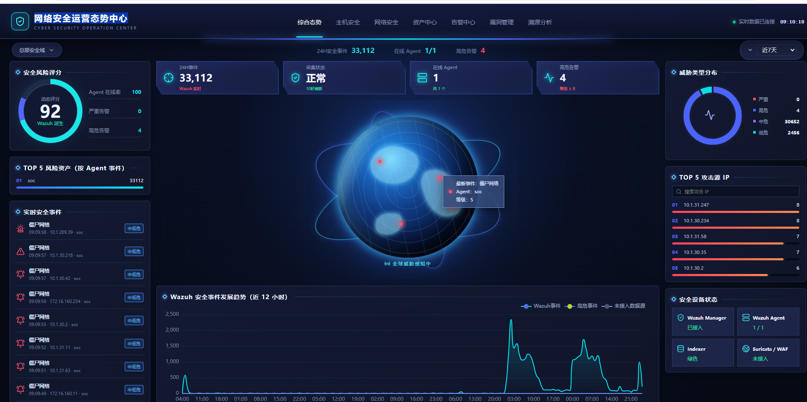
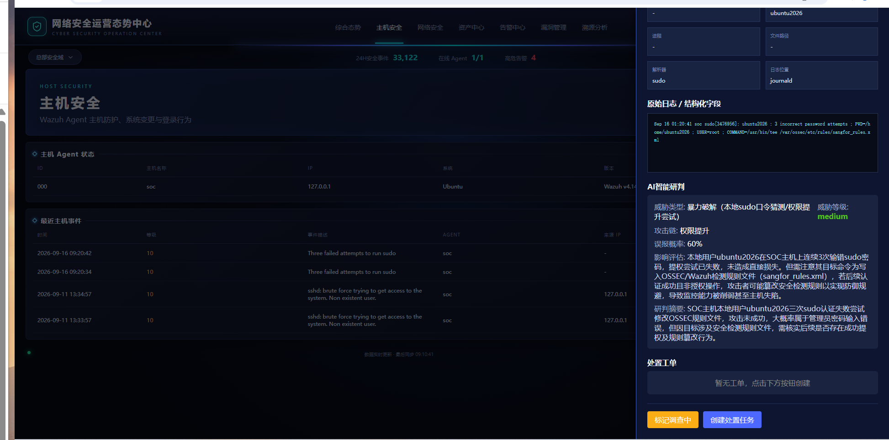
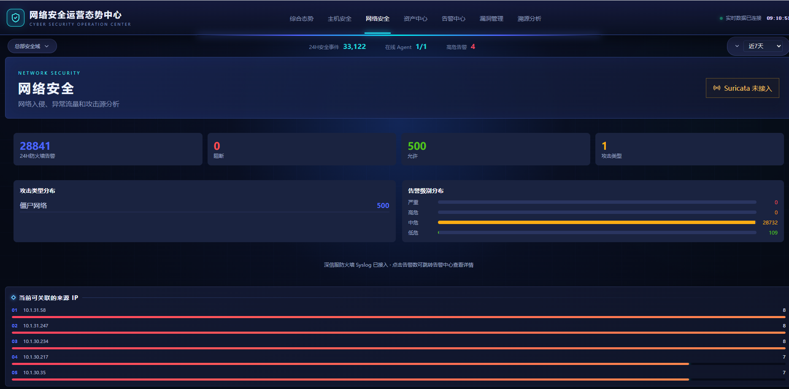
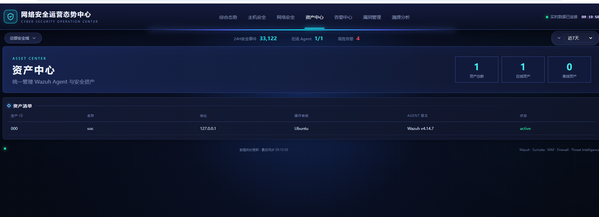
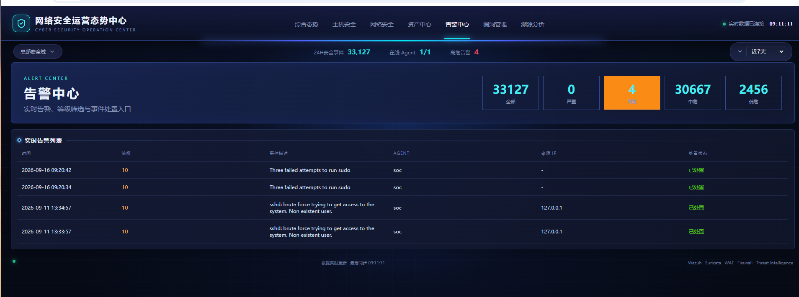
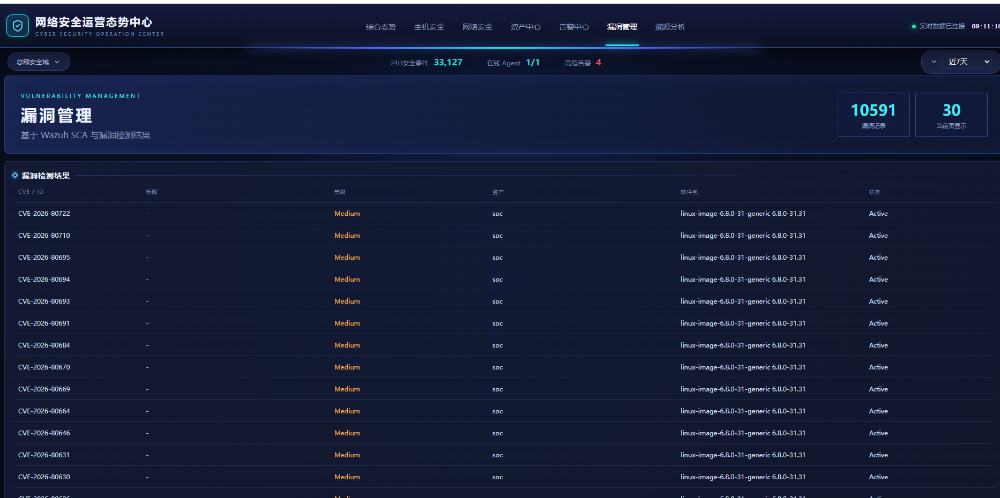
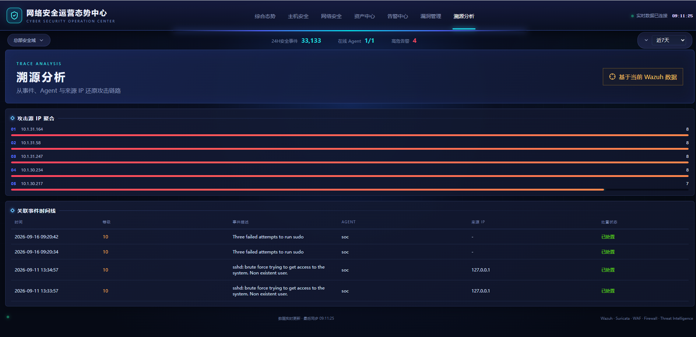
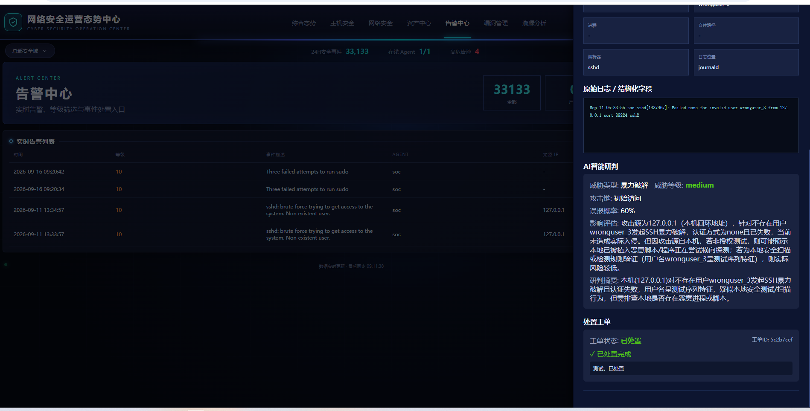

# 智能SOC安全运营平台

基于 Wazuh + Shuffle + AI大模型 + TheHive 的一体化安全运营平台，包含态势感知可视化大屏、AI智能研判、工单处置闭环。

## 架构概览

```
┌─────────────────┐    ┌─────────────────┐    ┌─────────────────┐
│   态势感知大屏   │───>│   SOC API 后端   │───>│   Wazuh Indexer  │
│   (React/Nginx) │    │   (Python)      │    │   (Elasticsearch)│
└─────────────────┘    └─────────────────┘    └─────────────────┘
                                │
                                ├──> AI大模型 (GLM-5.3)
                                ├──> TheHive (工单系统)
                                └──> SQLite (本地缓存/工单)
```

## 核心功能

### 1. 安全态势感知大屏
- **综合态势首页**：实时事件流、风险评分、威胁分布、攻击源TOP5
- **告警中心**：级别筛选（严重/高危/中危/低危）、时间范围筛选（今天/24h/7d/30d）
- **漏洞管理**：CVE漏洞列表分页、详情抽屉、CVSS评分
- **资产中心**：Wazuh Agent状态、操作系统、在线率

### 2. AI智能研判
- 高危告警自动触发AI分析
- 威胁类型、攻击链、影响评估、误报概率
- 研判结果持久化存储，重复查看不消耗Token

### 3. 工单处置闭环
- 标记调查中 / 创建处置任务 / 填写处置结果
- 告警列表实时显示处置状态（已处置/调查中/待处置）
- 与TheHive集成，支持工单同步

### 4. 多源日志接入
- Wazuh Agent主机日志
- 深信服防火墙Syslog（UDP 514）
- 自定义Decoder和Rule规则

## 界面预览

### 综合态势首页
实时安全事件、风险评分、全球威胁感知、攻击源TOP5



### 主机安全 + AI智能研判
Wazuh Agent状态、事件详情抽屉、AI自动研判结果



### 网络安全（防火墙）
深信服防火墙告警接入、攻击类型分布、告警级别统计



### 资产中心
统一管理Wazuh Agent资产，在线率统计



### 告警中心
实时告警列表、级别筛选、处置状态跟踪



### 漏洞管理
基于Wazuh SCA与漏洞检测器，分页展示CVE漏洞



### 溯源分析
攻击源IP聚合、关联事件时间线、还原攻击链



### 告警详情 + AI研判 + 工单
AI智能研判持久化、处置工单闭环、已处置状态显示



## 技术栈

| 组件 | 技术 | 版本 |
|------|------|------|
| Wazuh | SIEM/XDR | 4.14.7 |
| TheHive | 工单系统 | 5.7.3 (Community) |
| 后端API | Python + http.server | 3.x |
| 前端 | React + ECharts | 编译后静态文件 |
| 数据库 | SQLite + Wazuh Indexer | - |
| AI模型 | GLM-5.3 (智谱) | - |
| 部署 | Docker + systemd | - |

## 项目结构

```
soc-platform/
├── backend/
│   ├── soc_api.py          # 态势感知后端API (端口8090)
│   └── soc_automate.py     # SOC编排自动化脚本 (端口8181)
├── frontend/
│   ├── index.html          # 入口页面
│   ├── app.js              # React编译后前端代码
│   └── app.css             # 样式文件
├── config/
│   ├── ossec.conf          # Wazuh Manager配置
│   ├── local_decoder.xml   # 自定义Decoder
│   ├── sangfor_rules.xml   # 深信服防火墙规则
│   └── nginx-default.conf  # Nginx配置
├── scripts/
│   ├── wazuh-agent-install-linux.sh    # Linux Agent一键安装
│   └── wazuh-agent-install-windows.bat # Windows Agent一键安装
├── docs/
│   └── screenshots/                    # 平台界面截图
├── requirements.txt        # Python依赖
└── README.md
```

## 部署要求

- Ubuntu 22.04 / 24.04
- Docker & Docker Compose
- Python 3.8+
- 内网环境（无需公网，AI模型走内网API）

## 快速开始

### 1. 部署Wazuh

参考 [Wazuh Docker](https://documentation.wazuh.com/current/deployment-options/docker/index.html) 部署单节点：

```bash
git clone https://github.com/wazuh/wazuh-docker.git -b v4.14.7
cd single-node
docker-compose up -d
```

### 2. 部署态势感知后端

```bash
# 复制后端代码
sudo mkdir -p /data/soc
sudo cp backend/soc_api.py /data/soc/
sudo cp backend/soc_automate.py /opt/soc-automate/

# 创建systemd服务
sudo cp config/soc-realtime-api.service /etc/systemd/system/
sudo systemctl daemon-reload
sudo systemctl enable --now soc-realtime-api
```

### 3. 部署前端

```bash
# 复制前端文件
sudo mkdir -p /data/soc/frontend
sudo cp frontend/* /data/soc/frontend/

# 配置Nginx
sudo cp config/nginx-default.conf /data/soc/nginx/
```

### 4. 接入防火墙日志

在Wazuh Manager的 `ossec.conf` 中添加：

```xml
<remote>
  <connection>syslog</connection>
  <port>514</port>
  <protocol>udp</protocol>
  <allowed-ips>172.16.0.0/16</allowed-ips>
</remote>
```

## 配置说明

### 环境变量/配置文件

- `wazuh-credentials.txt`：Wazuh API凭证
- `soc_api.py` 顶部：AI模型配置、API地址
- `ossec.conf`：Wazuh Manager主配置

### AI模型配置

```python
AI_API_URL = 'https://your-ai-api/v1/chat/completions'
AI_API_KEY = 'your-api-key'
AI_MODEL = 'glm-5.3'  # 支持 GLM-5.3, DeepSeek, Kimi 等
```

## API接口

| 接口 | 方法 | 说明 |
|------|------|------|
| `/api/metrics` | GET | 综合态势数据（支持range参数） |
| `/api/vulnerabilities` | GET | 漏洞列表分页 |
| `/api/tickets` | GET/POST | 工单CRUD |
| `/api/ai/analyze` | POST | AI智能研判 |
| `/api/ai/analysis/<id>` | GET | 查询已保存的AI研判结果 |

## License

MIT License

## 致谢

- [Wazuh](https://wazuh.com/) - 开源SIEM
- [TheHive](https://thehive-project.org/) - 安全工单
- [GLM](https://www.zhipuai.cn/) - 智谱AI大模型
